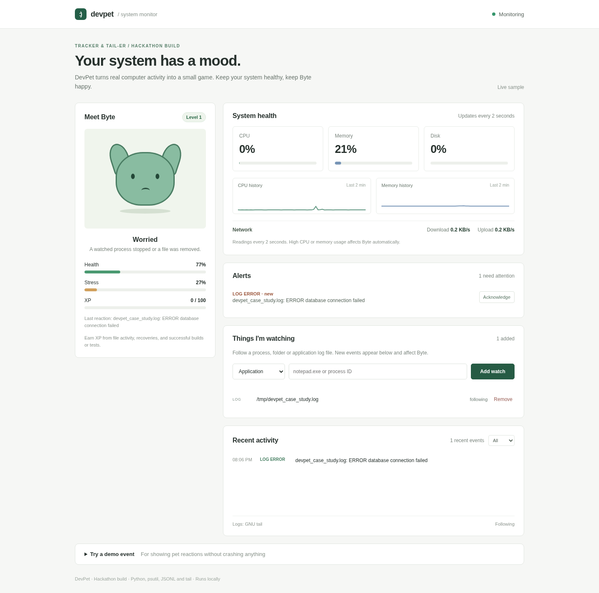

# DevPet

**Your system has a mood.** DevPet is a Windows-friendly system monitor with a virtual pet called Byte. It started as a small project for the **Tracker & Tail-er** hackathon.



Byte reacts to real system events: sustained high CPU/RAM, watched processes starting or stopping, changes in watched folders, log errors, and successful test or build commands. It's a local MVP, not a Task Manager replacement.

## What's in the MVP

- **System metrics:** CPU, RAM, disk usage, and network upload/download rate. Samples are taken every **2 seconds**. The dashboard keeps **60 samples** (roughly 2 minutes) for CPU and RAM history.
- **Process tracking:** Watch a process by its name or PID, see if it's running and its approximate RAM use, and log its start/stop events. A process stopping is **not** proof of a crash.
- **Folder tracking:** Detect new, modified and deleted files by comparing file metadata on each scan. The first scan establishes a baseline.
- **Live application logs:** Select a text `.log` file. DevPet reads only new lines, tags `ERROR` and `WARNING` messages, and handles incomplete lines and common rotation/truncation cases.
- **Event-driven pet:** Real log events change Byte's health, stress, mood and XP. Repeated errors from the same log are rate-limited so they can't instantly drain Byte's health.
- **Alerts:** High CPU/RAM, stopped processes, failed tests/builds and log warnings/errors appear in an alert list. You can acknowledge an alert; CPU/RAM and process alerts are marked recovered when the monitored condition clears.
- **Local saves:** Pet progress, selected watches, events and alert status are stored in `data/save.json` and restored on restart.
- **Demo buttons:** Optional simulated events let you show Byte's reactions safely. They're marked `demo`, and award no XP.

## How it works

```text
CPU/RAM/network readings    Process and folder watchers    App log reader    Test/build CLI
            \                     |                      |               /
             +--------------------+----------------------+--------------+
                                  |
                           JSON-line events
                          data/events.log
                                  |
                     tail -n 0 -F events.log
                           (PowerShell fallback)
                                  |
                         Event handler
                         /           \
                Alerts + history    Byte's mood/XP
                         \           /
                      Local browser dashboard
                        (refreshes every 1s)
```

The backend emits one JSON object per line. A **real `tail` subprocess** follows the event log where available; the event handler processes new lines to update the pet and alert state. On Windows without GNU `tail`, the fallback is PowerShell's `Get-Content -Tail 0 -Wait`.

The backend is event-driven. The browser polls the local API once a second; **it does not use WebSockets**. High CPU/RAM alerts use a 90% trigger and a 75% recovery threshold to avoid an alert on every sample.

## Run on Windows (no Ubuntu required)

1. Install **Python 3.10+** from [python.org](https://www.python.org/downloads/windows/) and ensure Python is available in PowerShell.
2. Extract the ZIP and double-click **`START_DEV_PET.bat`**. First launch creates `.venv` and installs `psutil`.
3. Open <http://127.0.0.1:8765>.
4. Leave the console window open; press **Ctrl+C** to stop the server.

Or use PowerShell:

```powershell
py -3 -m venv .venv
.venv\Scripts\python.exe -m pip install -r requirements.txt
.venv\Scripts\python.exe app.py
```

You can also double-click `SHOW_LIVE_LOGS.bat` while DevPet is running. For the **literal GNU `tail`** command on Windows, install [Git for Windows](https://gitforwindows.org/) with its Unix command-line tools and ensure `tail.exe` is accessible. Without it, DevPet can use Windows PowerShell instead.

## A short demo you can show in an interview

**1. Watch a real app.** Open Notepad, add a process watch for `notepad.exe`, then close Notepad. The activity feed should show `APP_STOPPED` and Byte will react. If you open Notepad again, you should see `APP_STARTED`.

**2. Watch an actual log file.** In PowerShell, create a safe test log:

```powershell
Set-Content -Path "$env:USERPROFILE\Desktop\devpet-demo.log" -Value "INFO app started"
```

In DevPet, choose **Log file** and paste that file's full path. Then run:

```powershell
Add-Content -Path "$env:USERPROFILE\Desktop\devpet-demo.log" -Value "ERROR database connection failed"
```

The new line is classified as `LOG_ERROR`, added to the alerts list and makes Byte worried. No real database needs to fail.

**3. Watch file changes.** Add a watch for a small test folder, then create or change a text file inside it. Byte earns XP from real activity.

**4. Show the CLI event pipeline.** Run a real test command through the wrapper:

```powershell
py -3 devpet_cli.py test -- py -3 -m unittest discover -s tests
```

If the test command exits successfully, DevPet writes a `TEST_PASSED` event. Use `SHOW_LIVE_LOGS.bat` to show JSONL events arriving as they happen.

## Files

```text
app.py                 Local HTTP server and API
monitor.py             OS samples, process/folder watches, event and pet logic
log_reader.py          Incremental text-log reader and severity classification
devpet_cli.py           Real test/build command wrapper
static/                 HTML, CSS and vanilla JavaScript
START_DEV_PET.bat       Windows launcher
SHOW_LIVE_LOGS.bat      Terminal log follower
tests/                  Automated tests
docs/                   Dashboard preview
```

## Tests

```powershell
py -3 -m unittest discover -s tests -v
```

**31 automated tests passed in the development environment**. They cover the event pipeline, API, watch configuration, actual file changes, process stop detection, application-log ingestion, log truncation/rotation, alerts, and saved state. Please run this command on your own Windows machine too; Windows launch and shell integrations have not been verified on every version of Windows.

## Scope and limitations

- All data is kept locally. The server binds to `127.0.0.1`; it doesn't send data to a cloud service.
- Watches are **opt-in**. Folder monitoring compares file metadata, not file contents. It doesn't record who changed a file.
- Text log entries can contain sensitive information. DevPet makes a basic attempt to redact fields such as `password=` and `token=`, but **do not watch logs containing secrets or personal data**.
- Log polling is bounded to avoid freezing the interface under a sudden flood of log messages. This isn't a full production log-ingestion platform, so some lines can be dropped at high volume.
- A selected process stopping isn't necessarily a crash; no claim is made about the cause.
- No cloud accounts, AI, databases, or WebSockets are needed. The project prioritises being understandable and demonstrable in a hackathon setting.

**Stack:** Python, `psutil`, Python standard-library HTTP server, JSONL, GNU `tail`/PowerShell log following, HTML, CSS and vanilla JavaScript.
